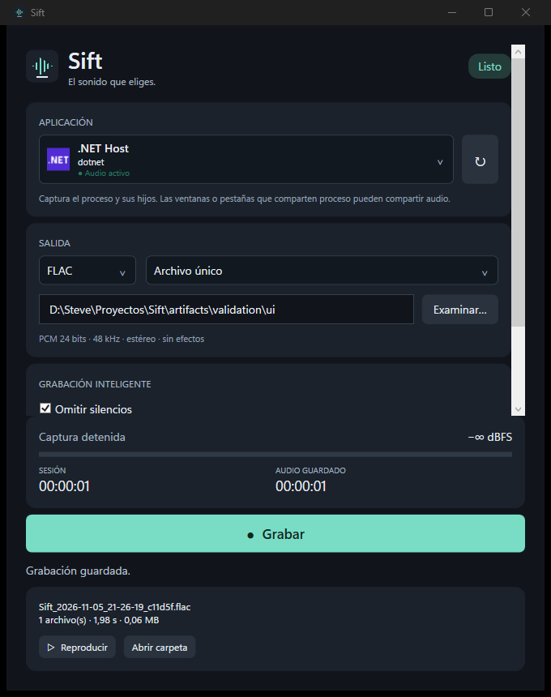

# Sift

Lightweight native Windows application for per-application audio recording, silence removal and audio segmentation. Spanish interface. Local processing only.

**0.1 preview** — functional process-loopback recording, not yet a stable release. See [validation](docs/validation.md) for executed checks and remaining hardware/soak tests.



## Features

- Select running applications by real icon, friendly name and window context; refresh on demand. Audio activity is a snapshot at refresh time.
- WASAPI process loopback includes the selected process and its children. Never records a microphone or falls back to system audio.
- FLAC by default, or PCM WAV with RF64 for large files. No normalization, effects, crossfades or automatic gain changes.
- Optional internal silence removal, independent edge trim, conservative optional brief-edge event removal.
- One concatenated file or separate activity sequences. RMS/hysteresis detection, configurable pre/post-roll and silence timeout.
- Live level, session time, estimated retained duration, finalized duration/size, playback and open-folder actions.
- Background capture, bounded capture queue, explicit discontinuity/overflow errors and recoverable intermediate PCM.
- Atomic per-user preferences in `%LOCALAPPDATA%/Sift/settings.json`; corrupt settings fall back to defaults. Dark interface, keyboard access, scrolling and DPI-aware WPF rendering.

## Requirements and installation

Windows 11 x64, ordinary user account and a working Windows audio service. Extract the **entire** `Sift-win-x64.zip` and run `Sift.exe`. No installer, administrator rights, Visual Studio or separately installed .NET runtime is required for the portable build. Keep the `codec` folder beside the executable. Unsigned preview builds can show Windows reputation prompts.

No stable GitHub release is published yet. Build locally or download a Windows CI artifact when available.

## Use

1. Select the application that produces the sound. Refresh if it opened after Sift.
2. Choose FLAC/WAV, destination and single-file/separate-file mode.
3. Choose silence and edge options; advanced detection values are hidden by default.
4. Press **Grabar**. Waiting for sound still means capture is running.
5. Press **Detener**. Sift finalizes the audio off the UI thread, then offers playback and the destination folder.

The session timer measures wall time; retained duration during capture is an estimate. The result reports exact saved frames. In separate-file mode the minimum duration applies to each activity sequence. Silence timeout groups sequences; pre/post-roll determine the retained margins. Brief-edge removal discards complete first/last activity events below the minimum, so enable it only when short legitimate sounds are not wanted.

## Audio fidelity

Sift explicitly requests **48,000 Hz, signed 24-bit PCM, stereo** from Windows process loopback, checks the returned format and writes those bytes unchanged. Windows may resample/remix/quantize source streams to this capture format. These settings describe the capture stream, not the original application's source quality or the physical output device mix format. FLAC is verified lossless relative to the PCM supplied to its encoder. No artificial quality claim is made about source bit depth.

WAV uses RIFF with a reserved header chunk, switching to RF64 beyond the traditional 4 GiB limit. Player RF64 support varies. No MP3 or source-native multichannel/automatic format negotiation in this version.

## Build and development

Install the .NET 10 SDK on Windows. PowerShell, Git and the SDK's MSBuild are sufficient; a separate Visual Studio installation is unnecessary.

```powershell
./scripts/bootstrap.ps1
./scripts/build.ps1
./scripts/test.ps1
./scripts/run.ps1
./scripts/publish.ps1
```

Scripts work regardless of the current directory. Publishing produces `artifacts/Sift-win-x64/Sift.exe` and `artifacts/Sift-win-x64.zip` as a self-contained folder. Single-file extraction is intentionally avoided for predictable WPF/codec deployment.

Optional **real audio test**, which plays short test tones through the current output:

```powershell
./scripts/validate-audio.ps1
```

This test requires an interactive Windows audio environment; CI only runs deterministic processing/codec tests. Use `tests/Sift.Probe <pid> <seconds> <output.wav>` via `dotnet run --project tests/Sift.Probe -- ...` for targeted diagnostics.

## Recovery and disk usage

Capture first spools `.sift-pcm` plus a `.json` format/options sidecar **in the selected destination**, then exports on stop. Full untrimmed audio temporarily consumes about 1.04 GB/hour; finalization additionally needs room for WAV and FLAC. No quota or free-space reservation is imposed. Disk errors preserve the temporary files; do not delete them until recovery succeeds.

```powershell
./scripts/recover.ps1 -Pcm 'D:/Recordings/file.sift-pcm' -Output 'D:/Recordings/recovered.wav'
```

Recovery keeps every complete PCM frame without trimming and never modifies the source. It requires the development SDK; an integrated recovery UI is not included yet. A power failure can lose buffered filesystem data. Final outputs are never overwritten; names include a timestamp and random suffix. Completed files and failed recovery data are not automatically deleted. Successful temporary spools are removed only after all requested exports complete.

## Known limits

- Capture isolation is **by process tree**, not window/tab. Browser tabs and shared helper processes cannot always be isolated individually. Selecting a child captures that child and descendants, not siblings. Choose the main application process where available. Sift does not secretly broaden the selected tree.
- Protected audio, elevated/restricted processes and some audio stacks may produce silence or reject activation. Child processes that outlive the selected root stop being recorded when Sift notices the root exit.
- Discovery includes windowed processes and audio-session processes. Some apps may appear more than once, with identical names; window context helps distinguish them. Activity badges update on refresh.
- Changing devices is not actively managed: process loopback is endpoint independent, but driver/audio-service errors end capture with recovery data preserved.
- Silence analysis has 10 ms resolution. Thresholds need adjustment for unusually quiet material. No algorithm can reliably distinguish a short legitimate effect from an unwanted click.
- Segments are exported when stopping, not delivered incrementally. Closing while recording finalizes before exiting; closing during finalization waits. Hard termination requires manual recovery.
- Hours-long sessions, disk-full hardware tests, RF64 playback above 4 GiB, device hotplug and varied DPI/accessibility configurations remain pending. Only a dark theme and the last result are included; no pause, recent-history browser or MP3.

## Architecture and privacy

C#/.NET 10, WPF, NAudio 3.3.0, official FLAC 1.5.0 command-line encoder, xUnit. [Architecture and decisions](docs/architecture.md).

No network calls, accounts, telemetry, DLL injection, virtual devices, registry edits or system volume/device changes. Development package restoration and GitHub CI use the network; the installed application does not.

Sift source: [MIT](LICENSE). Bundled dependencies have their own licenses, including the independent GPL FLAC executable; license texts and corresponding FLAC source accompany the portable package. See [third-party notices](THIRD-PARTY-NOTICES.md).
